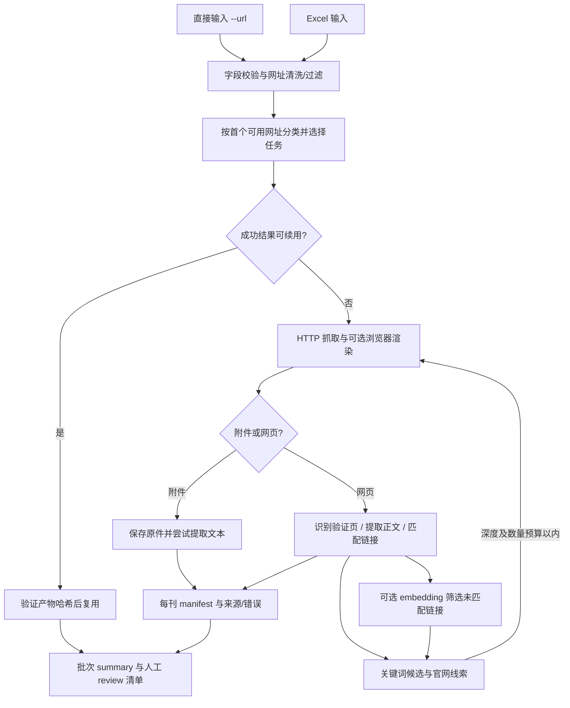

# 中文期刊投稿规范采集 Pipeline

## HTTP 优先、必要时使用正常 Chrome

新增 `--browser auto-chrome`：每个网址先用 Requests 获取并按现有规则判断内容是否足够。已取得有效正文、相关资料入口或附件时直接使用 HTTP 结果，不启动浏览器；遇到 HTTP 错误、识别到验证页、动态空壳页或没有足够资料线索时，才启动前述正常 Chrome 会话。需要浏览器的多个网址在同一本期刊内复用同一会话。

```powershell
.\.venv\Scripts\python.exe -X utf8 pipeline.py run --url 'https://jcupt.bupt.edu.cn/CN/column/column188.shtml' --name '中国邮电高校学报（英文版）' --browser auto-chrome --workers 1 --no-semantic --max-depth 3 --max-pages 30 --output outputs/jcupt
```

批量任务也可使用 `--browser auto-chrome`。它与原 `auto` 不同：原 `auto` 回退到无界面 Playwright，新模式回退到已验证有效的正常 Chrome。默认配置仍为 `auto`，需要显式传入新模式，或将 `config/pipeline.toml` 中的 `browser` 改为 `"auto-chrome"`。

Requests 通常更轻量，但不保证耗时最短：网络、重试和下载可能占主要时间；对已知总是返回 412 的站点，HTTP 优先会增加一次失败尝试，直接 `--browser chrome` 可能更快。HTTP 足够与否仍按关键词和资料链接判断，不能证明所有动态内容都已取得。Chrome 回退失败时保留已有静态结果并记录 warning；超过 `max_bytes` 直接报错，不通过浏览器绕过限制。

## 可见 Chrome 会话模式（2026-10-23）

遇到普通 HTTP 和无界面浏览器都失败、日常 Chrome 可以访问的站点，可显式使用新模式：

```powershell
.\.venv\Scripts\python.exe -X utf8 pipeline.py run --url 'https://jcupt.bupt.edu.cn/CN/column/column188.shtml' --name '中国邮电高校学报（英文版）' --browser chrome --workers 1 --no-semantic --max-depth 3 --max-pages 30 --output outputs/jcupt-chrome
```

在 Terminal 中先进入项目目录 `E:\1_2026_下半年\期刊收集项目\收集自动化\periodical-blueprint`。更换网站时，修改 `--url`、`--name`、`--output` 三项；单网址模式不读取 Excel。

- 从指定页面开始并跟进相关资料：保留上述 `--max-depth 3 --max-pages 30`。
- 只处理输入页本身：改为 `--max-depth 0 --max-pages 1`。发现后续链接而未访问时可能记录达到遍历限制，因此状态可为 partial。
- `--browser chrome` 是本次新增的正常 Chrome 会话模式，不是原来的无界面 Playwright 启动方式。运行时请保持自动打开的专用窗口，任务结束会自动关闭。

相对于旧流程，新模式的变化是：正常启动独立 Chrome 后通过本机 CDP 操作；允许初次 412 页面执行并等待后续成功的主文档；单刊共享会话用于资料页及附件；拒绝将 HTML 伪装附件保存为 Word/PDF。对该网址已实际完成采集，结果见 `outputs/jcupt-chrome-verified-20261023/`，当前状态为 partial，而非完整性认证。

### 输出目录维护

2026-10-23 清理后保留两批有效结果：`outputs/batch20-20261022/`（前20本期刊）和 `outputs/jcupt-chrome-verified-20261023/`（本刊验证结果）。临时诊断 profile、失败试跑和预演目录已清理。后续运行会按 `--output` 创建新目录。

`outputs/` 内均为生成结果，没有任务运行时可以删除不需要的批次；删除会丢失对应资料、清单与续跑记录。`.venv/`、`journal_pipeline/`、`config/`、`data/` 和 `tests/` 应保留。

需要安装 Google Chrome 和 `requirements-browser.txt`。程序会打开一个独立的可见 Chrome 窗口，通过随机端口的本机 CDP 连接操作页面；单刊内共享浏览器会话，任务结束自动关闭。不会读取日常 Chrome 的个人配置或 Cookie，也不会修改 `navigator.webdriver`、关闭证书校验或自动操作验证码。它保留 `auto/off/always` 原有行为；配置中的 `browser` 也可设为 `"chrome"`。

此模式等待页面的后续导航，并检查最终主文档响应，不会仅因首次 412 就退出。附件请求使用同一浏览器上下文的 Cookie；返回 HTML 的伪附件会记为错误。`max_bytes` 校验保存前的单个响应大小，不限制浏览器子资源流量，也不限制附件完整缓冲前的下载流量。网络和代理沿用 Chrome 的环境，与 Requests 的环境变量代理可能不同。

2026-10-23 诊断中，标准 Playwright 启动的 Chromium/Chrome 对此网址收到初次 412 后转为空白 400；独立正常启动的 Chrome 则从 412 转为 200，并显示投稿资料。该模式基于这个实际对照加入，不保证所有站点均可访问，也不表示资料已全部收齐。安装旧版 DOC 转换工具、人工处理验证码和核对来源仍需按下文执行。

新增浏览器回归可运行 `python -X utf8 -m unittest discover -s tests -v`；当前 15 项测试只访问本地 HTTP 站点，需要本机 Chrome 和 Playwright，覆盖 HTTP 优先、Chrome 延迟启动与复用、初次 412 后跳转、会话下载、伪附件拒收、大小限制、永久错误及原 HTTP 模式。

本项目支持直接输入一个网站网址，或从 Excel 期刊清单批量读取网址，定位投稿须知、作者园地、格式要求和模板等页面，保存网页文字与原始附件，并输出可追溯的采集清单和人工复核列表。

当前范围是**采集、可选本地语义筛选与文本提取**。不包含数据库建库、生成式 LLM 判断、OCR 或论文自动排版。关键词及向量相似度都是筛选线索，不能认证官网身份，也不能保证某本期刊的全部要求已被采齐。

## 1. 项目结构

```text
periodical-blueprint/
├── README.md                    # 本项目说明，优先阅读
├── pipeline.py                  # 统一命令入口，可从任意工作目录执行
├── journal_pipeline/
│   ├── cli.py                   # 参数、任务选择、并发、运行锁和汇总
│   ├── config.py                # TOML 配置加载和校验
│   ├── models.py                # Journal / Resource 数据结构
│   ├── source.py                # 直接网址任务、Excel 校验、网址清洗与过滤
│   ├── rules.py                 # 链接匹配、平台分类、附件命名
│   ├── fetch.py                 # HTTP 重试、限速、可选浏览器
│   ├── extract.py               # HTML / DOCX / PDF / DOC / WPS 文本提取
│   ├── naming.py                # 按期刊名和资料名称命名，处理同名冲突
│   ├── semantic.py              # 可选本地 embedding、候选排序、正文语义验证与向量缓存
│   └── pipeline.py              # 单刊遍历、来源记录、状态、续跑
├── config/
│   ├── pipeline.toml            # 路径、请求参数、采集预算
│   └── rules.json               # 沿用并集中管理原项目词表和域名规则
├── data/
│   ├── raw/期刊链接.xlsx         # 正式输入，原始内容未修改
│   └── samples/                 # 去重后的历史采集材料及来源索引
├── tests/                      # Chrome 会话、下载与默认 HTTP 的本地回归
├── outputs/                     # 新运行结果，自动创建
├── requirements.txt             # 基础采集与提取依赖
├── requirements-browser.txt     # 基础依赖 + 可选 Playwright
├── requirements-semantic.txt    # 基础依赖 + 可选 Sentence Transformers
└── requirements-dev.txt         # 基础依赖 + pytest
```

正式操作使用根目录 `pipeline.py`。`data/samples/` 是去重后的历史材料，供人工参考，不会自动进入正式采集流程，也不代表新 pipeline 的联网采集结果。

## 2. 安装环境

需要 **Python 3.11 或更新版本**。以下 PowerShell 命令在项目根目录执行：

```powershell
cd 'E:\1_2026_下半年\期刊收集项目\收集自动化\periodical-blueprint'
python -m venv .venv
.\.venv\Scripts\python.exe -m pip install -r requirements.txt
```

下文使用 `python` 简写；使用虚拟环境时可全部替换为 `.\.venv\Scripts\python.exe`。macOS/Linux 的解释器路径为 `.venv/bin/python`。

需要处理 JavaScript 页面时，可额外安装浏览器依赖：

```powershell
.\.venv\Scripts\python.exe -m pip install -r requirements-browser.txt
.\.venv\Scripts\python.exe -m playwright install chromium
```

- DOCX：使用 `python-docx` 提取段落与表格。
- PDF：使用 `pypdf` 提取已有文本层；扫描 PDF 不做 OCR。
- DOC/WPS：可选安装 LibreOffice，并让 `soffice` 或 `libreoffice` 在 PATH 中可见；转换在独立临时配置目录执行，60 秒超时。未安装时仍保存原文件并记录 `unavailable`。
- ZIP/RAR：保存原文件，不自动解压。

## 3. 推荐操作流程

### 直接采集自己的网站：无需 Excel

在项目根目录执行：

```powershell
.\.venv\Scripts\python.exe -X utf8 pipeline.py run --url 'https://www.peaotec.com/' --name '压电与声光' --output outputs/peaotec
```

`--url` 直接创建一个网站采集任务，**不会读取默认或配置中的 Excel**。`--name` 可省略，默认以域名作为任务名称；ID 根据规范化后的网址稳定生成，可用于续跑。

网址可写为 `www.peaotec.com`，省略协议会补 `https://`。包含端口时请明确填写协议，例如 `http://localhost:8080/`。默认不会在 HTTPS 失败后改用 HTTP；如需处理只提供 HTTP 的公开站点，可以显式增加 `--allow-http-fallback`。此示例是命令用法，不能保证该站当前可访问。

建议首次使用时先预演，再实际采集：

```powershell
# 检查网址，生成任务清单，不访问网站
.\.venv\Scripts\python.exe -X utf8 pipeline.py inspect --url 'www.peaotec.com' --output outputs/peaotec-check

# 查看任务计划，不访问网站
.\.venv\Scripts\python.exe -X utf8 pipeline.py run --url 'www.peaotec.com' --name '压电与声光' --dry-run --output outputs/peaotec

# 实际采集，可直接调整遍历深度和数量
.\.venv\Scripts\python.exe -X utf8 pipeline.py run --url 'www.peaotec.com' --name '压电与声光' --browser auto --workers 1 --max-depth 3 --max-pages 30 --output outputs/peaotec

# 在同一个输出目录续跑；保留相同名称
.\.venv\Scripts\python.exe -X utf8 pipeline.py run --url 'www.peaotec.com' --name '压电与声光' --resume --output outputs/peaotec
```

运行后查看 `summary.csv`、`review.csv` 和任务子目录内的 `manifest.txt`。`run-plan.json` 与 `summary.json` 中的 `input_type` 为 `url`；计划中的 `input_url`、汇总中的 `input` 记录规范化网址，`input_sha256` 为 null，因为没有使用输入文件。

单个网站模式表示“从这个网址开始，沿相关链接采集”。仍沿用投稿格式相关关键词，可能跟进带明确提示的外站候选，不是任意网站的全站镜像工具。若只处理输入页，可指定 `--max-depth 0 --max-pages 1`；由于后续候选未被访问，清单可能显示达到遍历限制。

参数约定：`--url` 与 `--input` 互斥，也不能搭配 `--sheet`、`--journals`、`--limit`、`--all`；`--name` 只能配合 `--url`。既有域名排除规则仍适用，被排除的网址会明确报错。`--max-depth`、`--max-pages` 也适用于 Excel 模式。

### 可选功能：HTTPS 连接失败后回退到 HTTP

对“正文发现 www.peaotec.com，补全 HTTPS 后证书失败”的情况，可以执行：

```powershell
.\.venv\Scripts\python.exe -X utf8 pipeline.py run --url 'https://2fm.opticsjournal.net/journal/pa/news/pt21120300024rnuqw.cshtml' --name '压电与声光' --allow-http-fallback --max-depth 5 --max-pages 50 --output outputs/peaotec-fallback
```

回退默认关闭，也可在配置中设置 `http_fallback = true`。显式开启后，只在 HTTPS 发生连接、超时或 TLS 传输失败时，尝试一次相同主机、路径和查询参数的 HTTP 地址；仅支持默认 HTTPS 端口或 443。HTTP 401/403、其他普通请求错误不会触发回退。不会关闭 TLS 证书校验，也不会自动处理登录或验证码。

HTTP 为明文传输，是否允许使用由该开关控制。发生回退时，`warnings` 记录失败原因和两个地址，`visits[].protocol_fallback` 记录实际回退，产物保留请求来源和最终 URL。成功回退的任务仍会进入 `review.csv`，便于检查。协议回退不增加链接深度，但会增加实际网络请求数；回退仍失败时保留错误，不能保证站点一定可访问。

### 可选功能：本地 embedding 补充链接筛选

默认 `semantic = false`，普通采集不加载模型。开启后先保留关键词与附件规则命中，再对未命中的链接进行语义排序；即使已有关键词命中，也会尝试补充遗漏入口。

**首次准备**（需要联网安装依赖和下载模型，之后采集只读取本地文件）：

```powershell
.\.venv\Scripts\python.exe -m pip install -r requirements-semantic.txt
.\.venv\Scripts\python.exe -c "from sentence_transformers import SentenceTransformer; m = SentenceTransformer('BAAI/bge-small-zh-v1.5', device='cpu', trust_remote_code=False); m.save('models/bge-small-zh-v1.5')"
```

模型下载完成后，在项目根目录执行：

```powershell
.\.venv\Scripts\python.exe -X utf8 pipeline.py run --url 'http://www.peaotec.com/ydysg823/home' --name '压电与声光' --semantic --embedding-model models/bge-small-zh-v1.5 --allow-http-fallback --max-depth 5 --max-pages 50 --output outputs/peaotec-semantic
```

也可将 `--embedding-model` 设置为已经完整缓存的 `BAAI/bge-small-zh-v1.5`。本地目录参数相对于执行目录，跨目录运行时建议使用绝对路径。实际运行固定使用 CPU、`local_files_only=True`、`trust_remote_code=False`；缺少依赖或权重时明确报错，不会静默降级成关键词模式，也不会在采集过程中下载权重。检查输入或加 `--dry-run` 时不加载模型，因此预演不能证明本地模型已就绪。

筛选和验证过程：

1. 为页面链接收集文字、`title`/辅助标签、附近文字、前置栏目标题和可读路径，避免只编码“更多”两个字。知网 WKE 和 WKG 下载中心的 `downFileContentTypeTwo` 操作也可作为候选，由页面参数解析出对应的下载地址。
2. 默认对每页前 200 个未被规则选中、未访问且未被域名规则排除的链接编码；用配置中的 `semantic_queries` 作为检索目标。相同文本向量使用最多 2,048 条的内存缓存，同一次 CLI 运行共享模型并串行保护编码。
3. 达到 `semantic_threshold` 后，按分数选最多 `semantic_top_k` 条补充候选。默认阈值 0.8、最多 3 条；没有达标链接时一条也不补充。每页规则候选仍可超过 3 条，3 仅限制语义补充。
4. 对语义选中的网页，访问后再次用 `semantic_content_queries` 验证正文。对其他入口，如果正文没有内容关键词，也可通过语义验证保存。正文仍需至少 40 字；只评估前 8,000 字，按最多 400 字分块，使用最高分块判断。
5. 达到 `semantic_content_threshold` 才保存语义网页正文。语义选中的附件在提取文字后也要验证；正文不相关、文字过短、扫描件或压缩包等不可验证情况，保留原件，设置 `retained_for_review = true`，并记录 semantic_rejected/semantic_unverified，任务为 partial。规则选中的附件继续沿用既有处理方式。

候选排序不会提高全局 `max_pages` 或 `max_depth`。超过前 200 条评估范围会留下 warning。分数是余弦相似度，**不是准确率或概率**；0.8 只是初始配置，必须用真实正例和误例校准。如果替换模型，BGE 的中文检索指令和阈值也需重新评估，不保证任意模型可直接沿用。

可以直接调整语义参数：

```powershell
.\.venv\Scripts\python.exe -X utf8 pipeline.py run --url 'www.peaotec.com' --semantic --embedding-model models/bge-small-zh-v1.5 --semantic-threshold 0.85 --semantic-content-threshold 0.85 --semantic-top-k 3 --output outputs/semantic-trial
```

`--no-semantic` 可覆盖配置中的启用项，`--no-allow-http-fallback` 可关闭配置中的回退项。修改模型、查询描述或阈值会使旧续跑指纹失效；替换同一路径下的本地权重或查询同名远程模型的新版时，应主动不使用 `--resume`。需要可复现实验时，在 `embedding_revision` 中固定模型提交版本，或使用固定本地模型目录。

本地运行不会调用生成式 LLM 或按模型 API token 付费，但会消耗下载流量、CPU、内存、磁盘和时间。默认模式仍可在不安装语义依赖的情况下运行。模型与参数说明参考 [BGE 模型发布页](https://huggingface.co/BAAI/bge-small-zh-v1.5) 和 [Sentence Transformers 加载参数](https://www.sbert.net/docs/package_reference/sentence_transformer/model.html)。

下面是 Excel 批量模式的操作步骤。

### 第一步：检查输入，不联网

```powershell
python -X utf8 pipeline.py inspect --output outputs/inspection
```

检查工作表、表头、重复 ID、空值和网址；输出 `inventory.json` 与 `input-audit.json`。后者列明每条被过滤网址及被跳过行的原因。

2026-10-21 对附带输入的检查：2,666 条非空数据行，2,376 本保留至少一个可用网址，290 行被跳过；按首个保留网址分类为知网系 431、本地规则中的高校自建 463、专业平台 377、长尾 1,105。**这些是输入范围统计，不是成功采集数量，也不是已确认的中文期刊数量。**

与旧代码不同：某一网址被排除时，仍保留同一期刊的其他合规网址，因此不能直接套用旧文档的约 2,360 本统计。

### 第二步：预演任务选择，不联网

```powershell
python -X utf8 pipeline.py run --limit 5 --dry-run --output outputs/trial
```

生成 `run-plan.json`，记录所选期刊、输入文件 SHA256 和完整有效配置。

### 第三步：小样本采集

```powershell
# 默认前 5 本，使用静态 HTTP，适合先验证安装
python -X utf8 pipeline.py run --browser off --output outputs/trial

# 指定期刊；中英文逗号均可，名称须与 Excel 精确一致
python -X utf8 pipeline.py run --journals '压电与声光,比较法研究' --output outputs/named

# 调整试跑数量和并发
python -X utf8 pipeline.py run --limit 20 --workers 2 --output outputs/batch20
```

运行结束先看 `summary.csv`，再看 `review.csv`；定位到每刊目录的 `manifest.txt` 或 `manifest.json` 查看错误、来源和转换状态。

### 第四步：处理失败和续跑

```powershell
python -X utf8 pipeline.py run --limit 20 --resume --output outputs/batch20
```

`--resume` 只跳过同一输出目录中：状态为 `success`、期刊输入与配置指纹相同、所有已列出的原文件和提取文本 SHA256 校验通过的任务。失败、部分成功、缺文件或内容损坏均重跑。它是**期刊级续跑**，不恢复某一期刊内部的遍历队列。

续跑依然按本次 `--limit` / `--journals` / `--all` 选择任务；默认仍为前 5 本。需要重新抓取已成功站点的更新时，不传 `--resume`，或使用一个新输出目录。

### 第五步：确认试跑结果后全量执行

```powershell
python -X utf8 pipeline.py run --all --resume --output outputs/full
```

全量必须显式传 `--all`；`--limit 0` 不表示全量。实际耗时与站点响应、重试和浏览器启动有关，项目不承诺固定覆盖率或耗时。

## 4. Pipeline 工作原理



1. **输入**：`--url` 直接创建一个任务；Excel 模式按表头读取 `journal_id`、`期刊名`、`官网`，不依赖固定列号，单元格中的多个网址按换行分割。缺少协议时补 `https://`，保留查询参数，去除锚点，排除无效协议及域名范围外的网址。多个输入网址都会进入任务队列。
2. **抓取**：每刊独立 HTTP 会话。对请求异常及配置的 429/5xx 状态有限重试；同一进程的线程共享按主机限速。保留 TLS 证书校验；可显式允许 HTTPS 连接失败后尝试一次 HTTP。
3. **浏览器**：`auto` 在 HTTP 失败、链接较少或未命中关键词时尝试渲染；未安装 Playwright 或渲染失败会记录 warning，有静态结果时保留静态结果。`off` 禁用浏览器；`always` 对 HTML 尝试渲染。浏览器不处理验证码，不共享登录态。
4. **发现**：按层遍历，并在同一层内优先访问明确的投稿栏目和官网线索。关键词匹配覆盖常用中文和英文投稿入口。已知下载排行、普通论文下载接口和帮助视频会标记为 `out_of_scope`。排行或期次目录作为起点时，优先跟进可识别的同站期刊首页。普通下载和附件链接结合邻近栏目、链接文字和父页面判断，例如模板栏目里的 `Article.docx`。明确的跨站资料线索仍可访问，深度继续累计。开启 `--semantic` 后，使用本地 embedding 补充候选。
5. **提取**：网页优先 `main` / `article`，去除脚本、导航和表单控件，保留 ASP.NET 表单中的正文和段落内文字。通常需要至少 40 字并通过内容词或可选语义验证。清楚的短格式指令也可以保存。语义选中的网页仍须通过正文语义验证。附件由 URL 路径、响应头和文件名参数等线索识别。

知网下载中心中，像《流体机械》（WKE）的“论文编排格式”和《旅游学刊》（WKG）的“论文模板”可能使用 `href="#"`，实际下载由 `downFileContentTypeTwo` 触发。流程会解析该操作提供的三个 ID，按来源页面的平台路径访问同站附件地址，并在清单中记录 `site_action`。下载响应必须能识别为附件，HTML 响应会进入错误或访问受限记录。
6. **输出**：采集文件按“期刊名_资料名称”命名，记录请求/最终 URL、文件 SHA256、转换状态、访问深度、选择依据、语义分数和命中目标。JSON 清单使用临时文件替换方式写入。

## 5. 输入与配置约定

未指定 `--url` 时，输入默认 `data/raw/期刊链接.xlsx`，工作表默认 `期刊链接`。`编号`、`学科` 可以保留，但不是必要字段。每条有效记录必须有非空期刊名、唯一 `journal_id` 和至少一个可用网址；重复 ID 后出现的行会被跳过并记录。直接网址模式不需要这些 Excel 字段。

```powershell
python -X utf8 pipeline.py inspect --input 'D:\data\期刊链接.xlsx' --sheet '期刊链接'
python -X utf8 pipeline.py run --config config/pipeline.toml --limit 5
python -X utf8 pipeline.py run --help
```

`config/pipeline.toml` 中的相对路径相对于**配置文件目录**；CLI 提供的相对路径相对于**当前工作目录**。不传路径时使用项目内默认配置，因此可从其他工作目录调用 `pipeline.py` 的绝对路径。

| 配置 | 默认 | 含义 |
|---|---:|---|
| workers | 2 | 同时处理期刊数量 |
| timeout | 20 | HTTP 超时及浏览器导航超时，秒 |
| retries | 2 | HTTP 重试次数，不含初次请求 |
| delay | 1.0 | 同主机初始请求开始的间隔，秒 |
| max_pages | 30 | 每刊最多处理的队列 URL 数，包括失败和附件 |
| max_depth | 3 | 输入 URL 为第 0 层，最多继续发现 3 层 |
| max_bytes | 20971520 | 单次 HTTP 响应体/渲染后 HTML 上限，20 MiB |
| min_text_length | 40 | 去除链接后正文的最小字符数 |
| browser | auto | auto / off / always / chrome（直接正常 Chrome）/ auto-chrome（HTTP 优先，再正常 Chrome） |
| browser_wait_ms | 1500 | DOM 加载后的额外等待毫秒数 |
| discover_official | true | 是否跟进带明确网站提示的候选 |
| http_fallback | false | 是否允许 HTTPS 连接失败后尝试 HTTP |
| semantic | false | 是否启用本地 embedding 筛选与正文验证 |
| embedding_model | BAAI/bge-small-zh-v1.5 | 已缓存模型名或本地模型目录 |
| embedding_revision | main | 模型版本；可固定提交 ID |
| semantic_threshold | 0.8 | 链接语义候选最低分 |
| semantic_content_threshold | 0.8 | 正文语义验证最低分 |
| semantic_top_k | 3 | 每页最多追加的语义候选 |
| semantic_candidate_limit | 200 | 每页最多编码的未匹配链接 |
| semantic_queries / semantic_content_queries | 见配置 | 链接与正文各自的语义检索目标 |

`max_pages` 不是底层网络请求总数：自动重试、重定向和浏览器子资源会产生额外请求。`max_bytes` 不限制浏览器所有子资源的总体流量，HTTP timeout 也不是整个期刊任务的总时限。

词表、排除域名、平台标识在 `config/rules.json`。其中部分匹配沿用原项目的子串判断，可能误排或漏排；请结合 `input-audit.json` 审核。平台类别只用于统计，不代表已经实现各平台专用采集适配器。

`strong` 已补充“排版要求、版式要求、来稿要求、投稿模版、版权合同、版权转让合同、著作权转让”等明确名称；`content` 也覆盖排版、版式、模版和版权相关正文。`resource_hints` 控制哪些附近文字可作为资料链接线索。例如 `<p>版权合同：<span><a href="...">点击查看</a></span></p>`，或一段明确标注“投稿指南”的正文中出现外站网址。上下文只为通用标签或自身明确指向资料的链接补充依据，不借用其他兄弟链接的文字；常见内联标签可以穿透。同段中的广告等明确无关标签不会自动继承“版权合同”。发现候选后仍按域名排除规则、去重和全局采集预算处理。

### 示例：投稿须知栏目内的合同、指南和排版要求

规则模式即可执行，不需要安装模型：

```powershell
.\.venv\Scripts\python.exe -X utf8 pipeline.py run --url 'https://jcupt.bupt.edu.cn/CN/column/column188.shtml' --name '中国邮电高校学报（英文版）' --no-semantic --max-depth 4 --max-pages 30 --output outputs/jcupt
```

程序会尝试发现“版权合同”“投稿指南”和“中国邮电高校学报（英文版）排版要求”等入口，网页正文和下载附件都会继续按规则处理；`item28.shtml` 这种普通 HTML 内容页也可以保存，不要求目标必须是 Word/PDF。资料网址指向外站时仍累计链接深度、保留原始期刊身份。

也可直接处理排版正文页：

```powershell
.\.venv\Scripts\python.exe -X utf8 pipeline.py run --url 'https://jcupt.bupt.edu.cn/CN/column/item28.shtml' --name '中国邮电高校学报（英文版）' --no-semantic --output outputs/jcupt-layout
```

本次对这两张在线页面的读取返回 HTTP 412，未能核对其当前正文，也不将本地测试作为该站已成功采集的证据。代码回归用用户描述的栏目链接、排版正文、动态版权附件和外站网址结构验证；实际运行仍取决于站点可访问性，程序不会绕过验证机制。

## 6. 产物与状态

```text
outputs/trial/
├── input-audit.json
├── run-plan.json
├── summary.json                 # 本次所选任务的完整汇总
├── summary.csv                  # 每刊状态与数量，UTF-8 BOM，方便 Excel 打开
├── review.csv                   # 非 success 或存在 warning 的期刊
└── 期刊名_类别_ID摘要/
    ├── manifest.json            # 机器可读来源、产物、状态、错误和访问记录
    ├── manifest.txt             # 人工可读清单
    ├── submission-format.md     # 分类后的投稿格式证据和待核对事项
    ├── submission-format.json   # 条目、来源位置、分类和可能的字数冲突
    ├── 期刊名_投稿须知.txt
    ├── 期刊名_排版要求.txt
    ├── 期刊名_版权合同.docx
    └── 期刊名_版权合同.docx.txt
```

先看 `submission-format.md` 里的字体字号、标题层级、段落、摘要与关键词、引证、参考文献、图表和篇幅等条目。原文条目附有来源网址及保存文本的行号。DOCX 模板里可识别的标题和标题层级样式标为观察结果，保留原件段落位置。报告列出未能核实的格式入口和可识别的稿件字数区间差异，供人工复核。`summary.csv` 中的 `format_requirements` 和 `format_review` 分别是证据条目和待核对事项数。旧 DOC 或扫描 PDF 的原件仍可在单刊目录查找。

### 文件命名和期刊身份

Excel 模式使用当前记录中 `期刊名` 列的原文，跨网站后仍保留这个名称，不会把外站域名或页面中的其他刊名当成新的任务名。直接网址模式使用 `--name`，不传时使用域名。

- 网页正文：`期刊名_资料名称.txt`，资料名称优先使用有效入口文字；直接输入正文 URL 时尝试使用正文标题或页面标题。
- 原始附件：`期刊名_版权合同.docx`、`期刊名_投稿指南.doc` 等，不以服务器的 `001.docx` 等编号作为主要识别名称。
- 转换文本：保留原文件名再加 `.txt`，如 `期刊名_版权合同.docx.txt`。
- 同名的不同资料：追加稳定 URL 摘要，仅用于避免覆盖；不会把所有产物都命名成纯摘要。
- Windows 非法字符会替换，过长名称会截短；完整期刊名、资料标题及原始附件名保存在 `journal_name`、`document_title`、`original_filename` 中。期刊目录仍带类别和 ID 摘要，以隔离同名期刊。

例如，当前 Excel 中此刊名称为 `The Journal of China Universities of Posts and Telecommunications`，批量采集就沿用这个英文原文；以上单站命令显式传入中文 `--name`，因此使用中文文件名前缀。原有输出不会被批量重命名或删除，最新结果以新运行清单为准。

| 状态 | 含义 | 推荐操作 |
|---|---|---|
| success | 至少有一份产物，未记录采集/转换错误或达到遍历上限 | 抽查内容，不能据此认定收集完整 |
| partial | 已有产物，但存在错误、无法转换或达到遍历上限 | 查看错误、补转换环境或调整预算后重跑 |
| no_match | 已获取页面但没有可保存内容 | 检查入口、关键词、浏览器和深度限制 |
| blocked | 无产物，遇到 HTTP 401/403 或识别到验证页 | 人工处理授权或更换公开来源 |
| failed | 无产物，出现请求/下载等错误 | 查看错误并修正网址或网络条件 |

浏览器降级单独记录在 `warnings`。已经获取有效静态内容时，仍可能为 `success`，同时进入 `review.csv`，提示人工检查动态栏目是否遗漏。

退出码：`0` 表示检查/预演完成，或本次采集全部 `success`；`1` 表示有期刊需要复核；`2` 表示参数、输入或配置错误。检查退出码应同时查看报告，不能只看终端“完成”。

同一个输出目录不允许同时运行两个 CLI 进程。异常强制退出可能遗留 `.run.lock`，须确认原进程已结束后再移除。不同批次建议使用不同 `--output` 目录；同目录重跑会更新对应清单和批次汇总，但不会删除上次未被本次引用的文件，**以最新 manifest 为准**。

### 查看实际访问深度与选择原因

`max_depth` 是允许的最大深度，不代表程序一定访问到那里。查看每刊 `manifest.json`：

- `crawl_stats.max_attempted_depth`：尝试处理的网址的最大深度，包括失败。
- `crawl_stats.max_fetched_depth`：已获取响应并记录最终 URL 的最大深度，不代表正文有效。
- `crawl_stats.max_saved_depth`：实际保存产物的最大深度；没有产物时为 null。
- `visits`：每个地址的 `depth`、状态、`selection` 和可选的 `protocol_fallback`、`content_validation`、`semantic_scan`。
- `candidates`：来源页、候选 URL、目标深度、`method`、命中词或语义分数/目标/上下文，以及 `queue_status`（queued、duplicate、max_depth、invalid_or_excluded）。
- `artifacts[].selection`、`artifacts[].content_validation`：为什么访问这份产物，以及为什么保存网页正文。

例如，输入平台页算第 0 层，投稿须知第 1 层，发现的投稿网站第 2 层，作者栏目第 3 层，栏目内附件可能第 4 层。HTTP/HTTPS 切换和服务器重定向不额外增加链接深度。`manifest.txt` 同样包含深度统计、候选选择原因和错误记录。新版本首次续跑会因流程版本变化重新采集旧结果。

## 7. 测试与验证边界

```powershell
python -m pip install -r requirements-dev.txt
python -X utf8 -m pytest -q
```

当前目录包含 15 项可复现的本地回归测试，需要本机 Google Chrome 和 Playwright。也可不安装 pytest，直接执行 `python -X utf8 -m unittest discover -s tests -v`。测试使用本地 HTTP 站点和真实 Chrome，覆盖静态正文、短资料入口和公开附件不启动浏览器，412/验证页/动态空壳回退，Chrome 会话复用，以及初次 412 后成功跳转、可见提示页延迟跳转、Cookie 会话附件下载、HTML 伪附件拒收、大小限制、永久错误和默认 HTTP 模式，不访问真实期刊网站。

历史说明中的 59 项测试源码不在当前项目目录，不能作为当前测试覆盖的证明。现有 15 项测试也不代表对语义模型准确率、所有平台或所有 CLI 功能完成了验证；真实网站采集结果和模型效果仍需单独核验。

当前限制：关键词可能误收或漏收；特殊 CMS、仅通过脚本点击下载、未提供文件名/MIME 的二进制接口、复杂 PDF 排版需后续适配。官网候选需要人工认证。真实网站的可用性与覆盖率必须通过独立联网试跑评估。

## 8. 后续维护建议

先对各平台抽取少量期刊试跑，按 `review.csv` 分类处理，再扩大全量。优先基于真实失败补充词表与平台适配，并用候选原因和正文验证记录校准语义查询与阈值；后续引入生成式 LLM 或规则数据库时，继续保留原始文本与来源关联。

历史样本的旧路径与当前文件映射保存在 `data/samples/index.json` 中。
